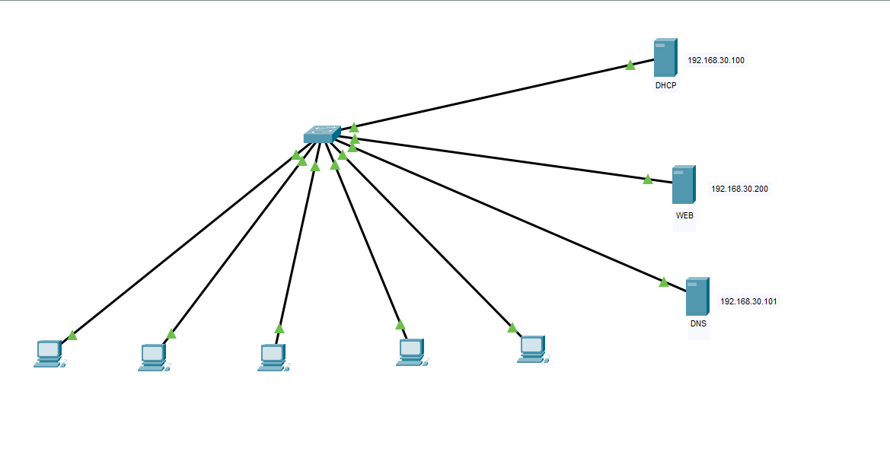
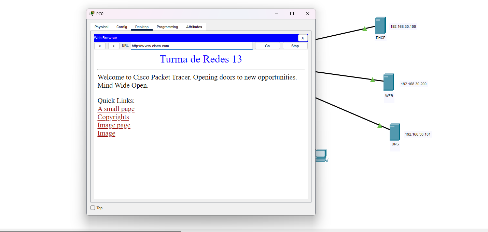

# Laboratório de Serviços de Rede - DHCP, DNS e WEB

Simulação de uma rede local (`192.168.30.0/24`) no Cisco Packet Tracer com distribuição dinâmica de endereços IP, resolução de nomes e serviço web.

## Topologia

A rede conta com:
- 1 switch interligando os dispositivos da LAN
- 1 servidor DHCP (`192.168.30.100`)
- 1 servidor DNS (`192.168.30.101`)
- 1 servidor WEB (`192.168.30.200`)
- 5 PCs clientes

## Endereçamento e serviços

| Dispositivo | Endereço IP | Função |
| :--- | :--- | :--- |
| Switch | — | Interconexão da rede local |
| Servidor DHCP | `192.168.30.100` | Entrega automática de IP para os hosts |
| Servidor DNS | `192.168.30.101` | Resolução de nomes de domínio |
| Servidor WEB | `192.168.30.200` | Disponibilização de página web |
| PCs (5) | `192.168.30.x` (DHCP) | Estações clientes |

## Como funciona
1. Os PCs solicitam configuração de rede via DHCP ao iniciar e recebem IP da faixa `192.168.30.0/24` junto com o servidor DNS (`192.168.30.101`).
2. Ao acessar o endereço no navegador, o cliente consulta o DNS (`192.168.30.101`) para obter o IP do servidor WEB (`192.168.30.200`).
3. O navegador abre a página hospedada no servidor WEB.

## Testes realizados
- Verificação da atribuição automática de IP nos PCs (`ipconfig /all` ou *IP Configuration*).
- Testes de conectividade com `ping` para os servidores.
- Consulta de nome (`nslookup`) e acesso pelo navegador web.

